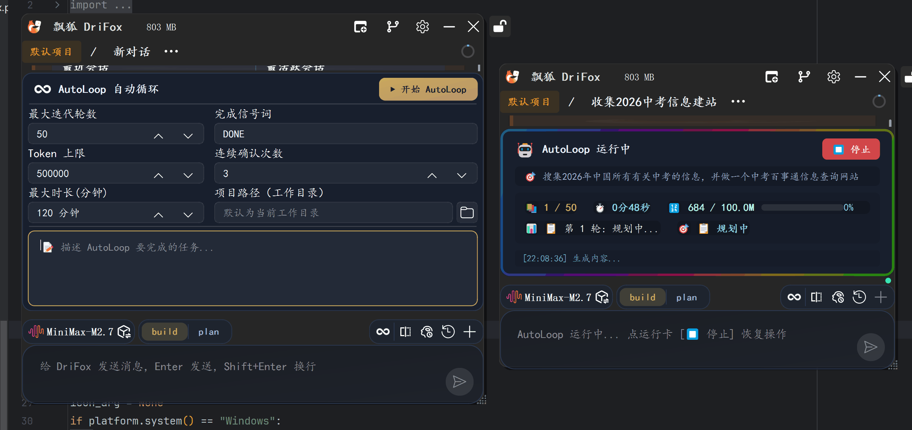
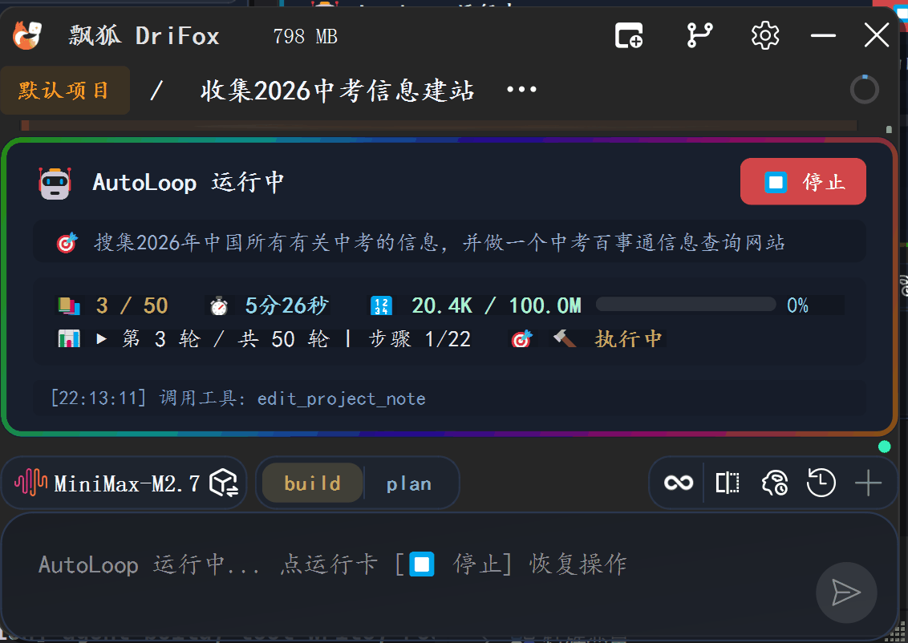

AutoLoop 自动循环模式
##############################

AutoLoop（自动循环模式）是 DriFox 的一种**自主执行引擎**——AI 在无需用户逐轮确认的情况下，自主完成"规划→执行→验证→修复"的迭代循环，直到任务目标达成或终止条件满足。

技术定位
========

.. list-table::
   :header-rows: 1
   :widths: 20 20 50

   * - 模式
     - 交互方式
     - 适用场景
   * - 普通模式
     - 每轮用户确认
     - 探索性任务、学习、需要人类判断
   * - AutoLoop 模式
     - AI 自主循环，异常时暂停
     - 自动化任务、批量处理、持续集成
   * - 团队协作模式
     - Leader 智能体调度子 Agent
     - 复杂多步骤工程任务

架构概览
========

::

    ┌─────────────────────────────────────────────────────────┐
    │                AutoLoopEngine 架构                      │
    ├─────────────────────────────────────────────────────────┤
    │  用户启动 AutoLoop                                      │
    │       │                                                 │
    │       ▼                                                 │
    │  ┌─────────────────┐                                    │
    │  │ 任务分析阶段     │  ← 解析用户目标，拆解子任务       │
    │  └────────┬────────┘                                    │
    │           ▼                                             │
    │  ┌─────────────────┐    ┌──────────────────┐           │
    │  │ 执行循环        │ ←─ │ 终止条件检查     │           │
    │  │  ┌───────────┐  │    │ • 目标达成 → 完成 │           │
    │  │  │ 规划阶段   │  │    │ • 超过轮次 → 停止 │           │
    │  │  ├───────────┤  │    │ • 错误超限 → 暂停 │           │
    │  │  │ 执行阶段   │  │    │ • 用户干预 → 中断 │           │
    │  │  ├───────────┤  │    └──────────────────┘           │
    │  │  │ 验证阶段   │  │                                    │
    │  │  └───────────┘  │                                    │
    │  └────────┬────────┘                                    │
    │           ▼                                             │
    │  ┌─────────────────┐                                    │
    │  │ 结果输出        │  ← 汇总执行日志和成果             │
    │  └─────────────────┘                                    │
    └─────────────────────────────────────────────────────────┘

核心机制
========

AutoLoop 不是什么黑魔法，它背后的核心机制是 **Agentic Loop（智能体自主循环）**：

.. list-table::
   :header-rows: 1
   :widths: 20 50

   * - 阶段
     - 说明
   * - 规划 (Plan)
     - AI 分析当前状态，决定下一步做什么，选择工具和参数
   * - 执行 (Execute)
     - 调用工具（读文件、改代码、跑命令），收集结果
   * - 验证 (Verify)
     - 检查执行结果是否符合预期，检测错误和异常
   * - 决策 (Decide)
     - 判断是否继续：目标达成则结束，出问题则调整策略重试

这四步构成一个闭环，AI 自主决定何时停止——不需要用户每轮都输入"继续"。

端到端示例：自动化 Bug 修复
================================

.. list-table::
   :header-rows: 1
   :widths: 8 30 30

   * - 轮次
     - AI 决策
     - 说明
   * - 1
     - `Bash("python run_tests.py")` → 发现测试失败
     - 运行测试，定位失败用例
   * - 2
     - `Read("src/buggy.py")` → 分析源代码
     - 读取问题代码文件
   * - 3
     - `Grep("def foo", "src/")` → 搜索相关定义
     - 查找相关函数实现
   * - 4
     - `Edit(old, new)` → 修复代码
     - 修改 bug
   * - 5
     - `Bash("python run_tests.py")` → 验证修复
     - 运行测试确认通过
   * - 6
     - `Bash("git diff")` → 生成差异
     - 展示修改内容供用户审查
   * - 7
     - 目标达成 → 结束循环
     - 输出汇总日志

每步都是 AI 自主决策的——它决定用哪个工具、传什么参数、何时停止。

它不是什么
==========

- **不是无限循环** — 有明确的终止条件（目标达成/轮次上限/错误阈值）
- **不是不可控** — 用户可随时中断，异常时自动暂停等待指令
- **不是批处理脚本** — 每一步都是 AI 动态决策，不是预定义流程
- **不是降低安全** — 敏感操作仍然需要权限确认

设计哲学
========

为什么需要 AutoLoop？

在普通模式下，AI 每执行一个工具就要等待用户确认下一轮——这对于多步骤的自动化任务（如"修复所有 lint 错误""批量重构 API 调用"）效率极低。AutoLoop 让 AI 像工程师一样自主工作，用户只需在关键节点做决策，而不是在每一步都做确认。

> **AutoLoop 的目标：让 AI 从"问答"走向"自主执行"。**
