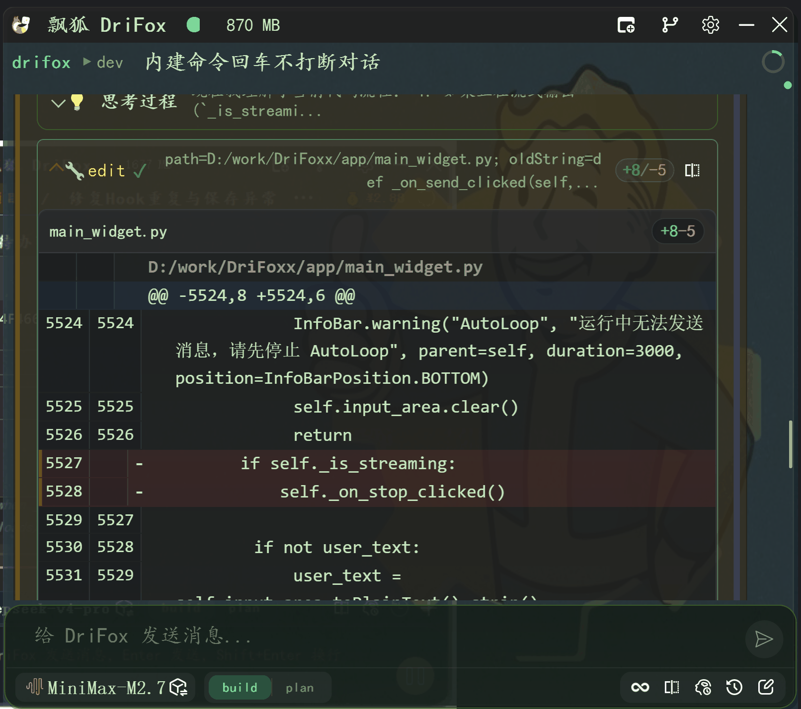

Gateway 多平台消息网关
######################

Gateway 是 DriFox 的**多平台消息网关**——它让 DriFox 不再局限于本地桌面对话框，而是能接入钉钉、Telegram、Discord、飞书、Slack 等即时通讯平台，实现"聊天框里的 AI 编程助手"。

一句话定义
==========

Gateway 是一个**协议适配层**，它将不同 IM 平台的消息统一为 DriFox 内部格式，让 AI 核心能力（代码编辑、工具调用、智能体协作）通过聊天界面即可使用。

技术定位
========

.. list-table::
   :header-rows: 1
   :widths: 15 50

   * - 维度
     - 说明
   * - 架构模式
     - 适配器模式 + 事件驱动
   * - 通信方式
     - WebSocket（本地）+ HTTP（远程回调）
   * - 消息格式
     - IM 平台原生 → 统一内部 Message 对象
   * - 平台隔离
     - 每个平台独立适配器，互不干扰

支持的平台
==========

.. list-table::
   :header-rows: 1
   :widths: 15 30 30

   * - 平台
     - 配置方式
     - 能力
   * - 钉钉 (DingTalk)
     - Webhook + Token
     - 消息收发、图片、文件
   * - Telegram
     - Bot Token
     - 消息收发、图片、命令
   * - Discord
     - Bot Token
     - 消息收发、富文本、命令
   * - 飞书 (Feishu)
     - Webhook + Token
     - 消息收发、富文本
   * - Slack
     - Bot Token + Signing Secret
     - 消息收发、消息块、命令

安装与配置
==========

Gateway 属于可选组件组，需单独安装：

.. code-block:: bash

    # 安装 gateway 依赖组
    uv sync --group gateway

配置方式：

.. code-block:: json

    {
      "gateway": {
        "telegram": {
          "enabled": true,
          "bot_token": "YOUR_BOT_TOKEN"
        },
        "dingtalk": {
          "enabled": true,
          "webhook": "https://oapi.dingtalk.com/robot/send",
          "secret": "YOUR_SECRET"
        }
      }
    }

架构原理
========

::

    Telegram ──┐
    DingTalk ──┤
    Discord  ──┼──→ [Gateway 适配层] ──→ [内部消息队列] ──→ [ChatEngine] ──→ [LLM]
    Feishu   ──┤                                         │
    Slack    ──┘                                         ├── [ToolExecutor]
                                                         ├── [SubAgentManager]
                                                         └── [PluginManager]

每个平台适配器独立运行，消息经过统一规范化后进入 DriFox 的引擎层处理。

端到端示例：通过 Telegram 修复代码
==================================

.. list-table::
   :header-rows: 1
   :widths: 10 40 40

   * - 步骤
     - 用户操作（Telegram）
     - DriFox 内部处理
   * - 1
     - 发消息：``修复 main.py 的 typo``
     - Gateway 收到 → 转内部 Message
   * - 2
     - —
     - ChatEngine 组装上下文 → 调 LLM
   * - 3
     - —
     - AI 调用 Read("main.py") 定位问题
   * - 4
     - —
     - AI 调用 Edit 修复 typo
   * - 5
     - —
     - AI 生成回复 → Gateway 发回 Telegram
   * - 6
     - 收到修复确认消息
     - 会话完成

设计哲学
========

为什么不在本地桌面用就行，还要做 Gateway？

因为**开发者的工作流并不总是在 PC 前**。Gateway 让 DriFox 的核心能力延伸到手机端，让 AI 编程助手变得"随身可用"——你可以在通勤路上通过 Telegram 让 AI 分析一个 bug，到工位时代码已经改好了。

> **Gateway 的目标：让 DriFox 从"桌面工具"走向"随身助手"。**
