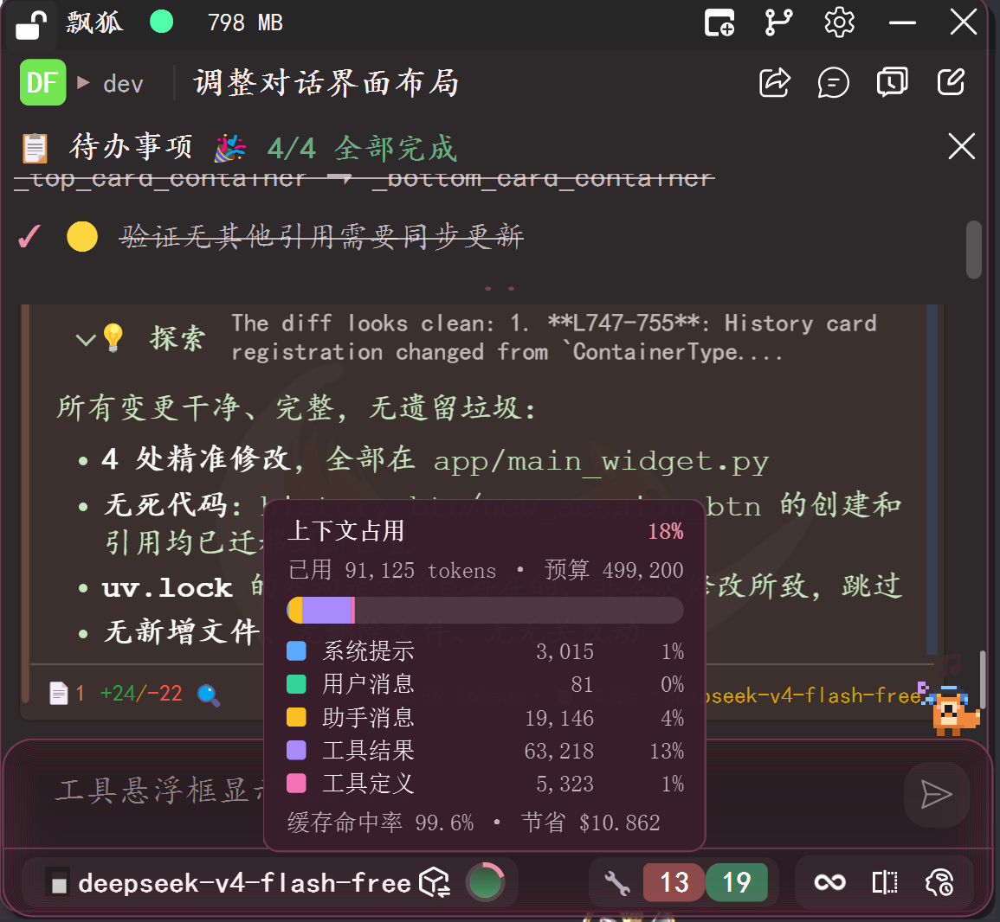

上下文压缩
##################

DriFox 的上下文压缩是一种**智能 Token 预算管理系统**——它在长对话达到 API 上下文窗口限制之前，自动对历史消息进行选择性摘要和截断，确保 AI 始终能「看到」最重要的上下文，而不会因超出 Token 上限而丢失信息。

技术定位
========

.. list-table::
   :header-rows: 1
   :widths: 20 50

   * - 维度
     - 说明
   * - 触发方式
     - 自动（超预算阈值）+ 手动（``/compact`` 命令）
   * - 压缩策略
     - 尾保留 + 工具调用配对保护 + LLM 摘要
   * - 可视化
     - 环形图实时显示占用比例
   * - 目标
     - 在信息损失最小化的前提下，将上下文控制在预算内

三层压缩策略
============

::

    Token 占用情况
         │
         ├── < 80% ──→ 不压缩，正常对话
         │
         └── ≥ 80% ──→ 触发压缩决策
                │
                ├── 第一层：尾保留截断
                │   └── 丢弃最旧的普通消息，保留最近 N 轮对话
                │
                ├── 第二层：工具调用配对保护
                │   └── 保留工具调用 ↔ 工具结果的配对关系
                │
                └── 第三层：LLM 摘要
                    └── compaction agent 生成语义摘要

.. list-table::
   :header-rows: 1
   :widths: 15 50

   * - 策略
     - 说明
   * - 尾保留截断
     - 优先丢弃最早的普通消息，保留最近的对话轮次，确保当前任务不丢失上下文
   * - 工具调用配对保护
     - 工具调用和对应的工具结果必须是原子对——要么都保留，要么都丢弃，避免上下文断裂
   * - LLM 摘要
     - 当简单截断不够时，使用专门的 compaction agent 生成历史摘要，用语义压缩代替简单丢弃

压缩触发条件
============

.. list-table::
   :header-rows: 1
   :widths: 30 50

   * - 条件
     - 说明
   * - Token 超过预算阈值
     - 默认 80%，可在设置中调整
   * - 工具迭代增量压缩
     - 每次工具调用完成后检查，超过阈值自动触发
   * - 手动触发
     - ``/compact`` 命令，支持自定义焦点和清空选项
   * - 强制紧急压缩
     - 极端情况（即将超限）下强制执行，只保留最近 2 轮对话

端到端示例：长对话自动压缩
==========================

.. list-table::
   :header-rows: 1
   :widths: 8 25 30

   * - 轮次
     - 事件
     - 压缩行为
   * - 1-20
     - 正常对话，逐步积累上下文
     - 无压缩
   * - 21
     - Token 占用达到 82%
     - 触发自动压缩
   * - 22
     - 系统检查历史消息
     - 标记可丢弃的早期轮次
   * - 23
     - 执行尾保留截断
     - 丢弃消息 1-8，保留 9-21
   * - 24
     - Token 占用回落到 60%
     - 继续正常对话
   * - 25-40
     - 继续积累，再次接近阈值
     - 触发 LLM 摘要
   * - 41
     - Compaction agent 生成摘要
     - 消息 9-25 被替换为一句摘要
   * - 42
     - Token 占用回到安全水位
     - 正常对话继续

它不是什么
==========

- **不是简单的截断** — 不是扔掉消息尾巴，而是智能选择保留什么、压缩什么
- **不是永久删除** — 压缩丢弃的只是上下文中的消息副本，原始会话记录不受影响
- **不是降低质量** — 压缩后的摘要仍然保留语义信息，AI 仍能理解任务背景
- **不是用户需要关心的事** — 压缩在后台自动执行，用户只需知道命令随时可用

设计哲学
========

上下文窗口是 AI 对话系统最宝贵的资源。一个 token 用完之前，你永远不知道它有多重要。

DriFox 的压缩策略遵循三条原则：

1. **最近的信息最重要** — 尾保留策略确保当前任务不丢失上下文
2. **工具调用是原子单元** — 保留工具调用和结果的配对关系，避免「调用了工具但不知道结果」
3. **语义优于原始文本** — 当空间不够时，用 LLM 摘要代替原始消息是更好的选择

我们的目标是：让用户**不需要关心 Token 预算**——压缩系统在后台静默工作，只在必要时才让用户感知。
