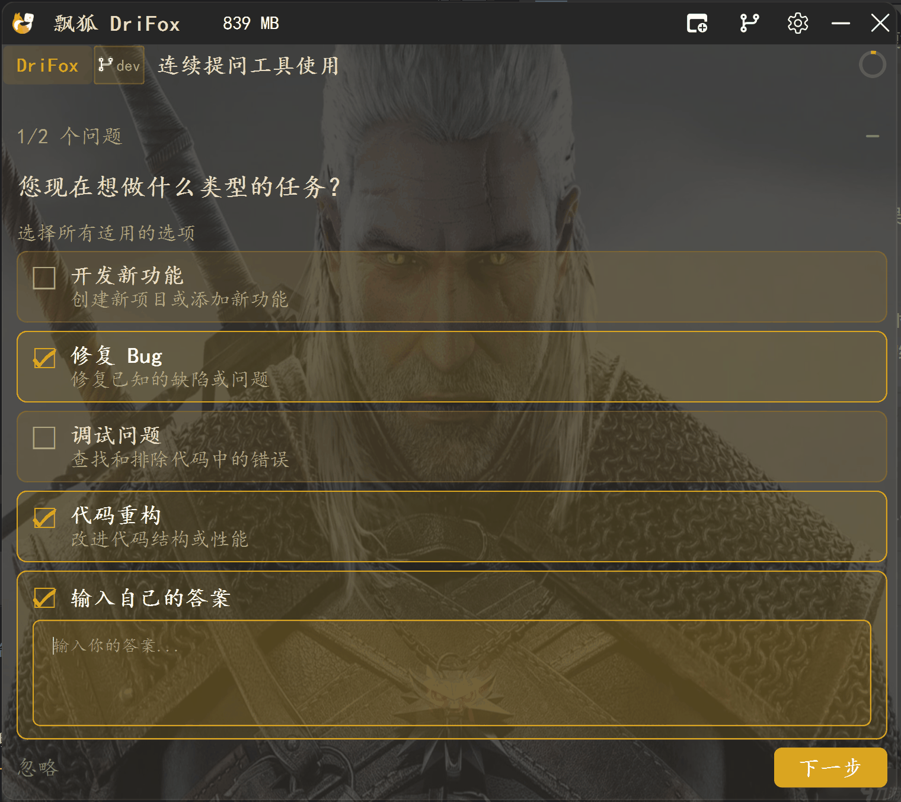

安全与权限模型
######################

当 AI 拥有完整的文件系统和命令执行权限时，安全的边界在哪里？

DriFox 采用 **三级权限体系 + 用户确认机制** 来确保 AI 的能力不被滥用——既给了 AI 足够的工具去完成工作，又把控制权牢牢握在用户手中。

一句话定义
==========

安全与权限模型是 DriFox 的**纵深防御体系**——它定义了 AI 能做什么、需要什么许可、以及异常时如何熔断。

三级权限体系
====================

.. list-table::
   :header-rows: 1
   :widths: 15 30 50

   * - 等级
     - 含义
     - 适用场景
   * - 🔓 Allow
     - 允许执行，无需确认
     - 读文件、搜索代码、查看 git 状态等只读操作
   * - ❓ Ask
     - **需要用户确认** 才执行
     - 写文件、运行命令、网络请求等有副作用的操作
   * - 🔒 Deny
     - 禁止执行，直接拦截
     - 高危操作（如删除全部文件、修改系统配置）

权限规则匹配
============

权限判定按以下优先级从高到低匹配：

1. **用户自定义规则** — 用户在设置中配置的覆盖规则
2. **工具默认规则** — 每个工具的预设权限等级
3. **全局默认** — 所有未明确配置的工具默认 Ask

MCP 工具权限
============

通过 MCP 协议连接的外部工具默认全部为 **Ask** 级别，即每次调用都需要用户显式确认。
用户可在设置面板中为特定 MCP Server 或工具调整权限规则。

Hook 系统安全控制
=================

Hook 系统提供额外的安全层：

- **PreToolUse** — 工具执行前 Hook 可拦截（BLOCK）危险操作
- **PostToolUse** — 工具执行后 Hook 可进行审计日志
- **决策控制** — Hook 通过 exit code 2 或 JSON ``{"decision": "block"}`` 实现拦截

端到端示例：权限决策链路
========================

.. list-table::
   :header-rows: 1
   :widths: 8 30 30

   * - 步骤
     - 事件
     - 权限判定
   * - 1
     - AI 决定修改文件
     - —
   * - 2
     - 调用 ``Write("src/main.py", new_content)``
     - 工具规则匹配：Write → Ask
   * - 3
     - 权限引擎检查自定义规则
     - 无覆盖规则 → 使用默认 Ask
   * - 4
     - PreToolUse Hook 检查
     - Hook 未拦截 → 继续
   * - 5
     - 弹出确认对话框
     - 用户点击「允许」
   * - 6
     - 工具执行 → 文件修改成功
     - —
   * - 7
     - PostToolUse Hook 记录审计
     - 日志入库

设计哲学
========

权限模型的核心原则：**最小权限 + 显式授权**。

- AI 默认只能**读取**，不能**写入**——写操作必须用户点头
- 用户可逐步"信任"特定工具或路径，减少重复确认
- 敏感操作（删除、覆盖、网络请求）始终需要确认
- Hook 提供"第二道防线"，可在工具执行前拦截

> **安全不是限制 AI，而是让用户敢于放权。**
