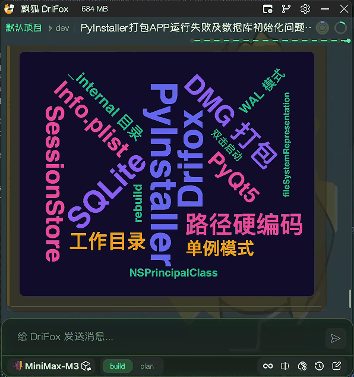

词云会话总结
##################

DriFox 内置 `/wordcloud` 命令，一键将当前会话内容总结为交互式 ECharts 词云。

功能概览
========

- 🎯 **一键生成** — 输入 `/wordcloud` 即可将整段对话提炼为词云
- 🎨 **焦点提取** — 支持可选参数指定提取方向，如 `/wordcloud 技术栈`
- 📊 **ECharts 词云** — 基于 echarts-wordcloud 渲染，支持交互
- 🏷️ **品牌配色** — DriFox 五色品牌色系，按权重自动分配
- 🔄 **自动分析** — 自动提取 15-30 个关键术语
- 🧠 **深度理解** — 结合会话上下文分析语义重要性

使用方式
========

::

    /wordcloud                   # 自动提取全量关键术语
    /wordcloud 技术栈            # 聚焦技术栈相关术语
    /wordcloud 问题点            # 聚焦问题与瓶颈
    /wordcloud 需求              # 聚焦用户需求与待办
